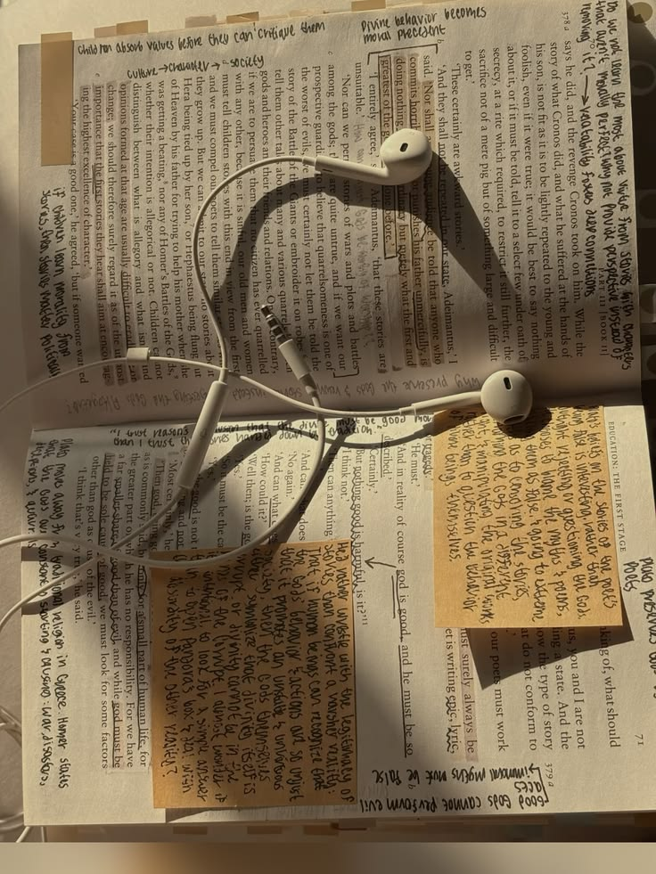

A commonplace book is a notebook where you copy out the things you want to keep: a sentence from a novel, a recipe, a line overheard on a train, a fact you will need again. The name comes from the Latin *loci communes*, the "common places" or headings under which a reader filed what they found.

Renaissance schoolboys were taught to keep one. Erasmus told students to read with a pen in hand and sort every striking passage under a heading, so that reading became a store they could draw on later. In 1706, John Locke's *A New Methode of Making Common-Place-Books* appeared in English, with an index system so careful that people kept using it for generations. Thomas Jefferson, Virginia Woolf and countless less famous readers kept their own. 

What I love about the idea is leaving a trace of the small details that stayed with you, the ones that lingered in your mind far longer than you ever expected. It is not about what happened to you, but about what caught your attention, and over the years it becomes a portrait of a mind assembled from other people's words. 

> Small fragments, pieced together like a collage, end up shaping part of who we are.

That is what this section is for. The Index is my box of keepsakes: books, films, papers, people and small discoveries, small pieces of memory, gathered one by one, that together describe a part of who I am.

