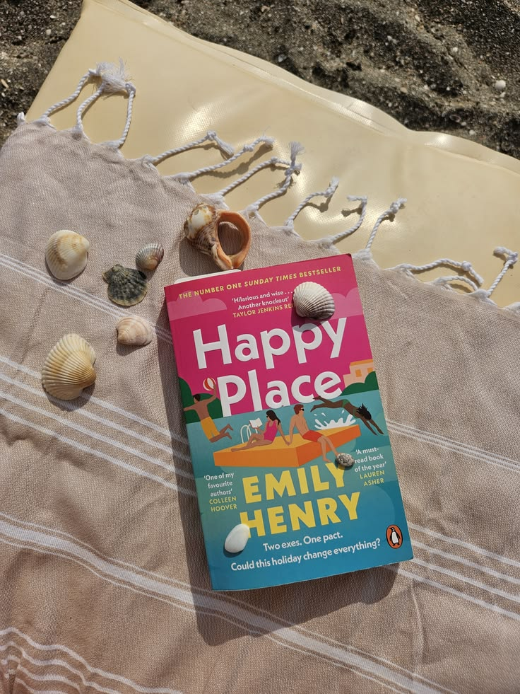

I spent this summer in Oxford and left my e-reader behind in France, so every one of these books was read on my laptop. I read in the in-between moments, the small pockets of quiet scattered through the day. Five books, all of them love stories. Here they are, from the one I liked least to my favourite.

## 5. *Happy Place* by Emily Henry

Like *High by the Beach*, further down, this book touched on a topic a bit more painful, here a breakup, but it never stops being a light read. 

> A light summer read, and sometimes that is all you want. 

## 4. *Love Song* by Elle Kennedy

I have a soft spot for Elle Kennedy. I read her Off-Campus series as a teenager and have read almost all of her books since. I just like the way she writes, and *Love Song* was no exception.

## 3. *Fever Dream* by Elsie Silver

What I like here was the idea of the dating show. I know it has been done before, but it is not one you come across often, and it made for a fun, entertaining read.

## 2. *High by the Sea* by Wren Amari

This one deals with trauma, but without ever feeling too heavy. The main character is the kind you start to love almost immediately, even if you do not understand her trauma until later on the book.

## 1. *The Wicked Sea* by Jordan Stephanie Gray

My favourite, for the fantasy: sirens, mythological creatures, the sea. That world has always drawn me in, and this book gave me all of it. 

